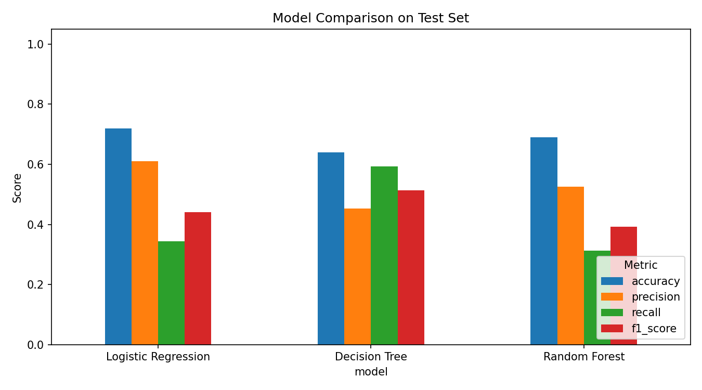
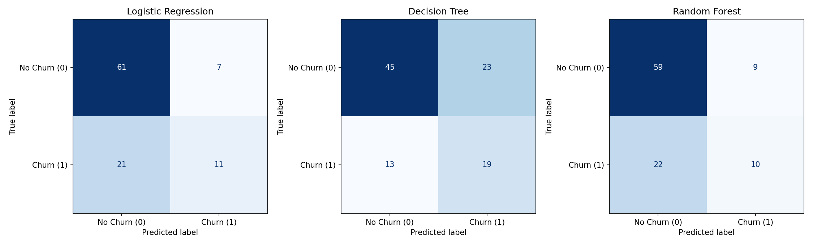
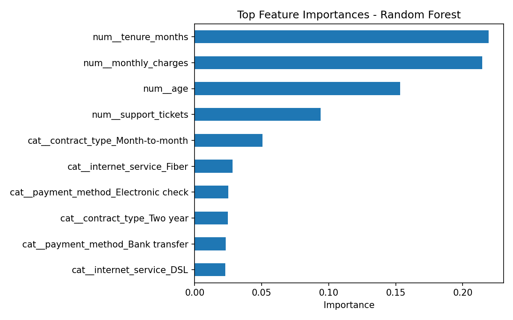

# Customer Churn Model Comparison (Python & ML)

Clean, leak-free Python machine learning pipeline comparing multiple classification models to predict customer churn (`classification_analysis.py`), complete with diagnostic plots, benchmark metrics, and an executive summary report (`final_report.pdf`).

## Project Overview & Deliverables
- `classification_analysis.py`: End-to-end preprocessing, leak-free train/test pipeline, model comparison across classifiers, metric export, and chart generation.
- `customer_churn_standard_dataset.csv` & `customer_churn_processed.csv`: Raw and processed customer churn datasets.
- `model_comparison.csv`: Comparative evaluation metrics across candidate classification models.
- `final_report.pdf`: Executive summary of methodology, results, and takeaways.
- `model_comparison.png`, `confusion_matrices.png`, `feature_importance.png`: Diagnostic visualizations.

## Visual Diagnostics

### Model Comparison

### Confusion Matrices

### Feature Importance

